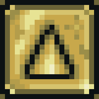

# Artifacts

rtifacts are among the most valuable sources of information and a great source of pride for the Travelers who discover them.

Unlike Worlds, which can be observed directly, and records from the Book, which may be damaged or imperfectly translated, artifacts serve as physical evidence of civilizations long since vanished. Many have been recovered from ruins, abandoned settlements, ancient fortresses, and locations whose origins can no longer be determined.

> The following records contain descriptions of discovered artifacts, reconstructions of their appearance, and all known information regarding their origin and presumed purpose.
{: .note }

---

<a class="card card-next" href="/Artifacts/Schemes">
  
Read next

  
Collection of Schemes

</a>

