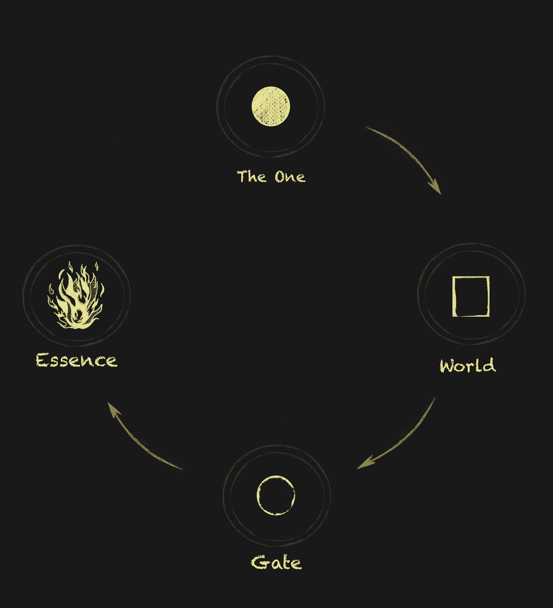
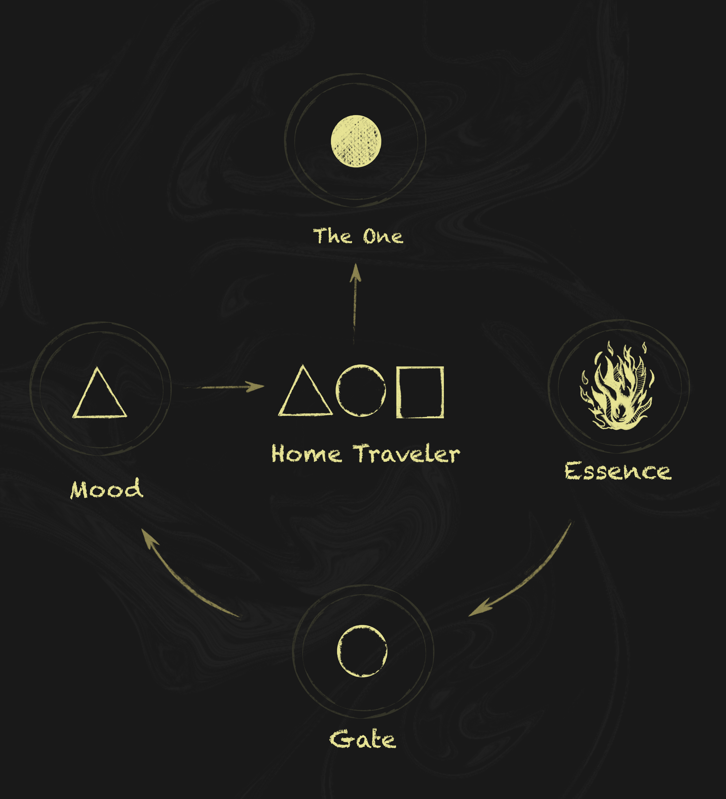

# Possible relationship

My sketches and observations exploring the possible relationship between the Path, the Travelers, and the mysterious Figurative Language.

  
  

---

<a class="card" href="/Fragments/README">
  
Back to

  
Fragments

</a>

<a class="card" href="/Artifacts/README">
  
Read next

  
Artifacts

</a>

