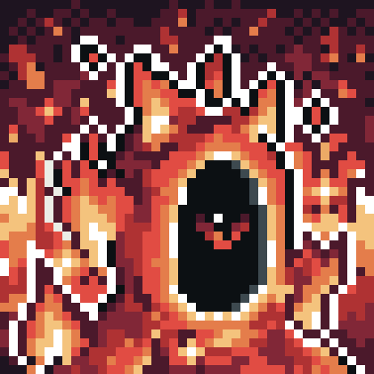

# Fireon

He is one of the first three. His Gate burns — or appears to burn, always. The civilization that created it vanished earlier than most others. How exactly — has not yet been fully determined, though it seems they did not leave of their own accord.

Faeron himself does not remember the moment of his activation. More precisely — he remembers the moment before, and the moment after. And between them — emptiness. For most Travelers, awakening is a starting point. For him — a question he is still searching for an answer to.

He once wrote to me, asking whether the Book contained anything about his civilization. To my surprise, the pages that might have mentioned his home World — have been torn out.

---


