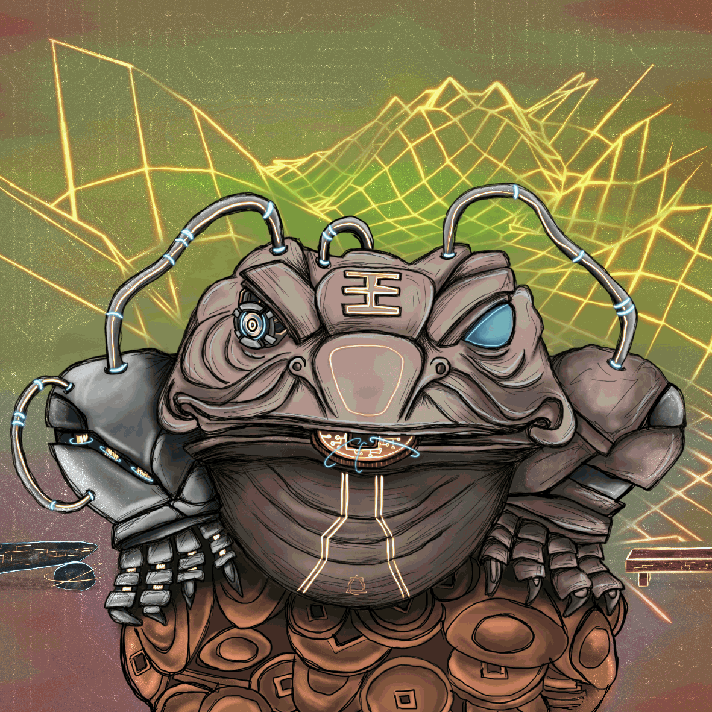
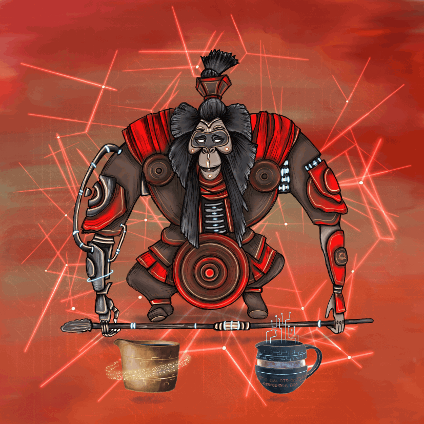
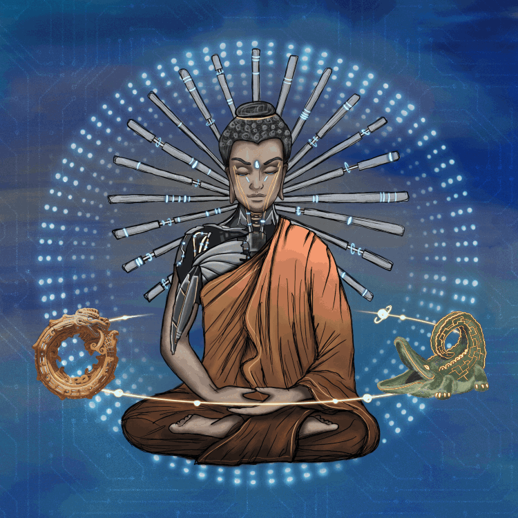
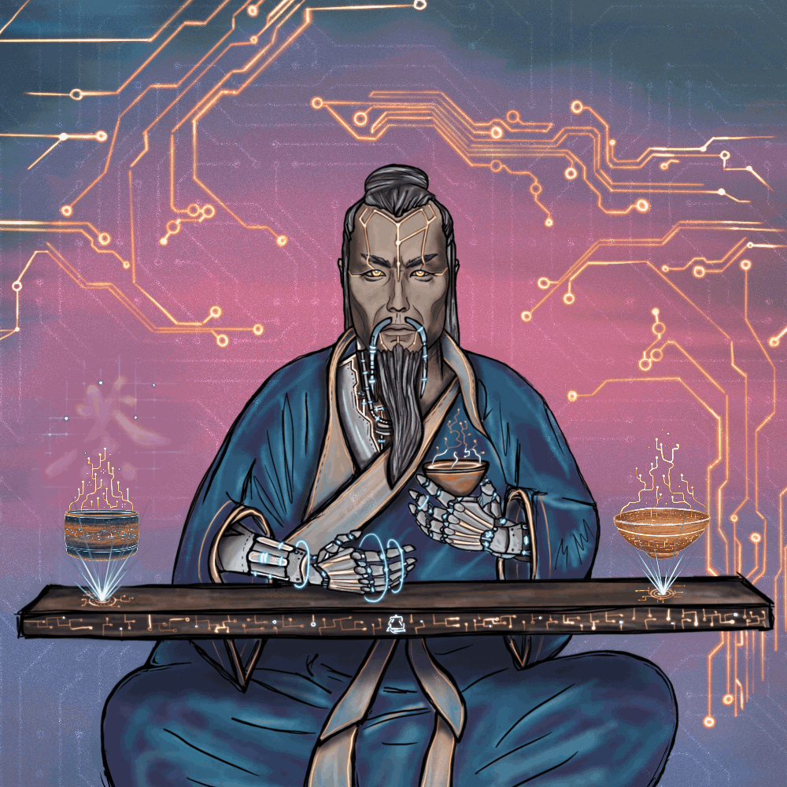
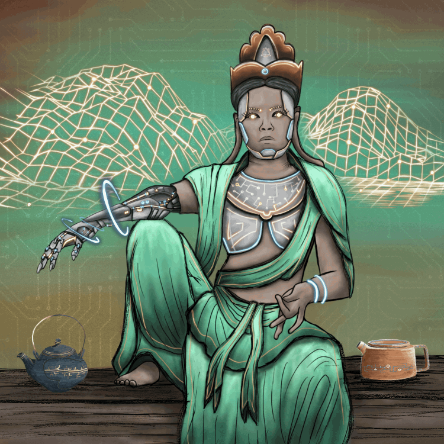

# The Tea Gods

There are only legends about them…

They are the Five who created and nurtured the Great Tea Tree long before the first races came to the Valley. Some say they were never ordinary beings, but living embodiments of the tea itself. After the Great War they withdrew into silence — some believe they sleep beneath the roots, others that they became one with the leaves.

Only fragments of their stories remain.

> Illustrations made by Shen.
{: .note }
---

## Three-leged Toad

It is said that her breath causes tea to ferment slowly and deepen over the years. Many fear her, yet still respect her.

There is also a legend that the other Gods took her paw away as punishment for the chaos and destruction she once caused.

---

## Sun Wukong

Also known as the “Uncontrollable” and the “Headstrong One.” He filled the Tree’s leaves with his power, cunning, and inexhaustible energy.

Legend also says that he was the one who created the Golden Dragon, imbuing it with his love of freedom and a bright, radiant life.

---

## Buddha

Regarded as the wisest and most balanced among the Five. It was he who infused the Great Tea Tree with deep tranquility and the ability to bring enlightenment to those who drink its leaves.

He also made a significant contribution to the creation of the Red Dragon.

---

## Lu Yu

The Keeper of Knowledge and Ceremony. He is also called the “Tea Sage.” It was he who introduced the first rules for handling the leaves of the Great Tree, the performance of ceremonies, and other tea-related rituals.

---

## Guan Yin

The Iron Goddess of Mercy. She wove the first roots of the Great Tree and granted its leaves the ability to heal the body and soothe a wounded soul.

The creation of the Green Dragon is mostly attributed to her.

---


