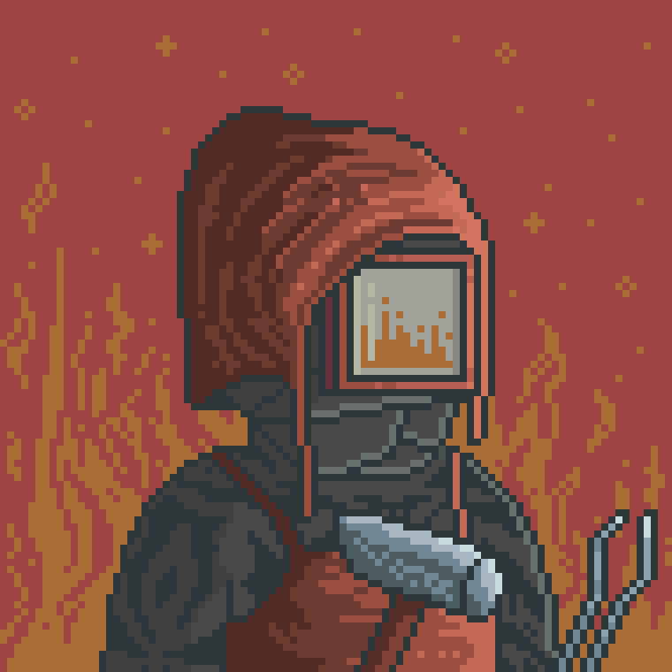

# The Blacksmith

Blacksmith is one of the villagers responsible for crafting and repairing tools used throughout the Valley.

Most metal objects found within the settlement — are believed to have passed through his forge.

Despite the simplicity of his work, many villagers consider his craftsmanship essential to the daily life of the Valley.

---

<a class="card" href="/Valley/Villagers/README#villagers-list">
  
Back to Villagers

  

</a>

<a class="card" href="/Valley/README">
  
Back to the Valley

  

</a>

