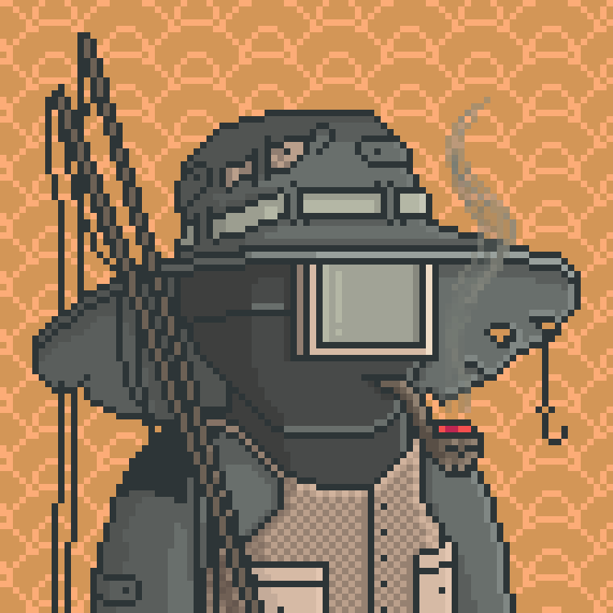

# The Fisherman

Fisherman is one of the villagers responsible for gathering food from the rivers and lakes surrounding the Valley.

He is known for spending long periods of time away from the settlement, often traveling between distant shores and quiet waterways rarely visited by others.

Some villagers believe that Fisherman knows parts of the Valley that do not appear on ordinary maps.

---

<a class="card" href="/Valley/Villagers/README#villagers-list">
  
Back to Villagers

  

</a>

<a class="card" href="/Valley/README">
  
Back to the Valley

  

</a>

