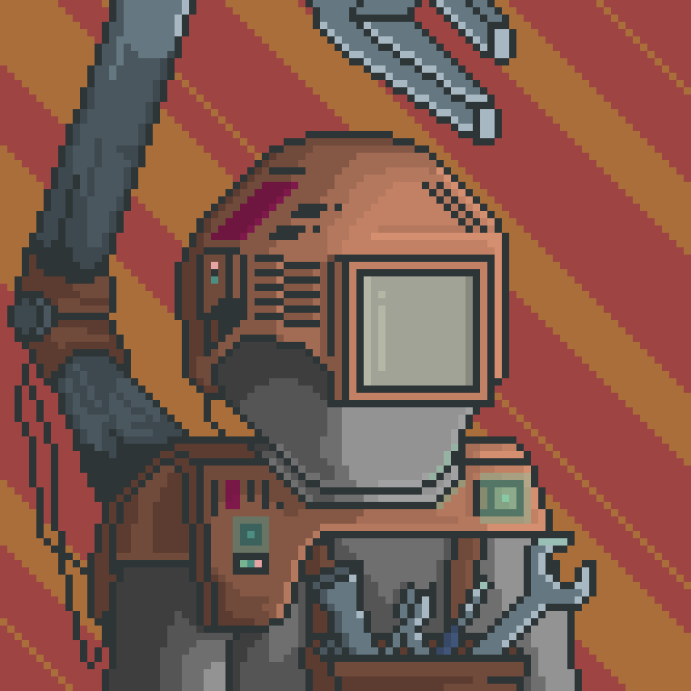

# The Mechanic

Mechanic is one of the villagers responsible for maintaining devices, tools, and various mechanisms used within the Valley.

Many damaged objects brought from old ruins or abandoned workshops are eventually taken to his station for repair or reconstruction.

Some villagers believe that Mechanic understands certain mechanisms whose origins are no longer remembered by anyone else in the Valley.

---

<a class="card" href="/Valley/Villagers/README#villagers-list">
  
Back to Villagers

  

</a>

<a class="card" href="/Valley/README">
  
Back to the Valley

  

</a>

