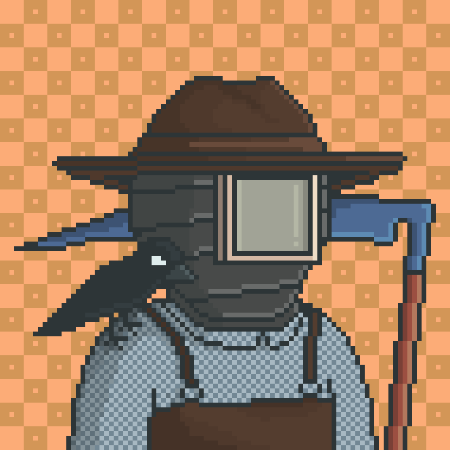

# The Tea Shearer

Tea Shearer is one of the villagers responsible for harvesting and processing tea leaves within the Valley.

Most tea prepared inside the settlement is believed to pass through his work before reaching storage or village kitchens.

Some villagers claim that Tea Shearer is capable of recognizing subtle differences in tea leaves that others fail to notice.

---

<a class="card" href="/Valley/Villagers/README#villagers-list">
  
Back to Villagers

  

</a>

<a class="card" href="/Valley/README">
  
Back to the Valley

  

</a>

