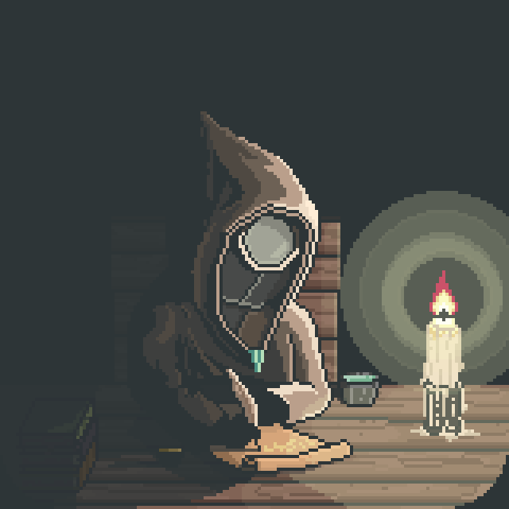

# Home's Journey Archive

f these records have truly been found by someone, then it is probably worth beginning with an explanation of where exactly this archive came from.

As far as I know, I am Teantist, a researcher and translator from the Valley of Tea Dragons. Most of my earliest memories are connected to this place, although many details of my own past still remain unclear even to me.

Many years ago, near the Tea Rock — a place that we Villagers of the Valley consider to be the grave of the Founder of the Village — I discovered an ancient book written in the figurative language. Much of its pages had been damaged by time: some fragments can no longer be read, certain symbols resist precise translation, and several sections appear to have been destroyed long before the book came into my possession.

It is the translation and study of this book that became the foundation for most of the records collected within this archive.

Many of the terms mentioned here — including the Valley, the Travelers, the Tavern, and the origin of tea itself — will be explored in separate records as the materials continue to be organized. However, I should warn in advance that not all information contained here can be considered entirely reliable. Some records survived only in fragments, while parts of these notes are based solely on my own observations and attempts to connect the surviving materials together.

At present, I continue my work on translating the Book and restoring the lost records.

If you truly intend to explore the universe of Home’s Journey together with me — then welcome to the Archive.

---

## Main topics:

  
<a class="card card-gap" href="/Cosmology">
  
Cosmology

  
The structure of existence before and after the Great Division

</a>

  
<a class="card card-gap" href="/Tavern/README">
  
The Tavern

  
The only stable place where all Paths eventually cross

</a>

  
<a class="card card-gap" href="/Worlds/README">
  
Home Worlds

  
Fragments of places that once were whole

</a>

  
<a class="card card-gap" href="/Fragments/README">
  
Fragments

  
Some random notes...

</a>

  
<a class="card card-gap" href="/Artifacts/README">
  
Artifacts

  
Objects recovered from Worlds that no longer exist

</a>

  
<a class="card card-gap" href="/Concepts/README">
  
Concepts

  
Terms and ideas that hold the Archive together

</a>

